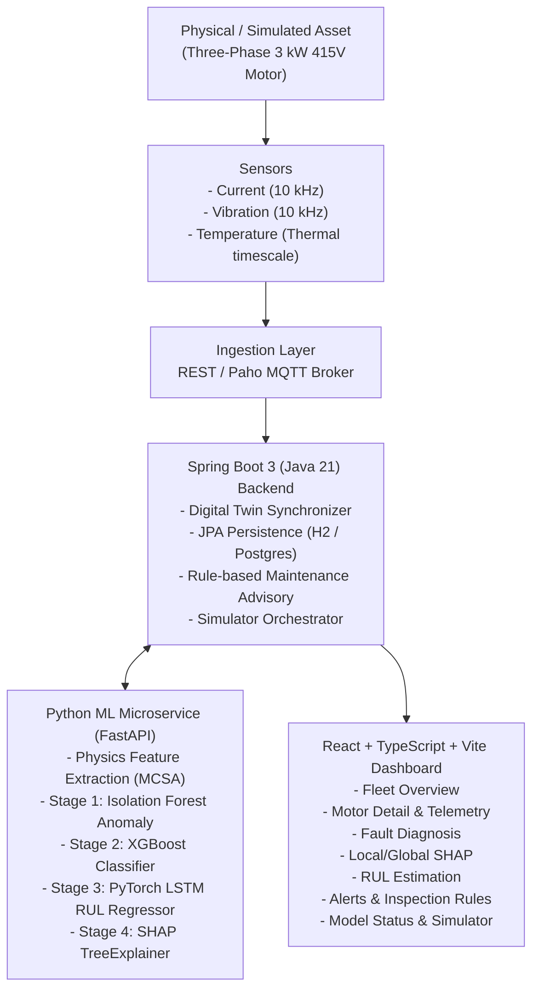

# Architecture Specification: Explainable Digital Twin for Predictive Maintenance of Three-Phase Induction Motors

## 1. Overview
The framework implements an end-to-end cyber-physical digital twin architecture for three-phase squirrel-cage induction motors (3 kW, 415 V, 50 Hz, 4-pole) corresponding to the IEEE research paper specifications by Aditya Gupta, Aditya Maurya, Ananya Sharma, Aryan Mishra (supervised by Ms. Monika Sharma).

## 2. Architectural Layers

### Layer A: Telemetry and Simulation Layer
- **Signals**: Stator Phase Current (10 kHz, 10,000 samples/sec), Radial Vibration Acceleration (10 kHz, 10,000 samples/sec), Winding Temperature (°C).
- **Physics Equations**:
  - Broken Rotor Bar current sidebands: $f_{br} = f_s(1 \pm 2ks)$ (e.g. 46 Hz and 54 Hz for slip $s = 0.04$).
  - Bearing ball pass outer/inner race frequencies: $f_{bpfo} = \frac{n}{2} f_r (1 - \frac{d}{D}\cos\alpha)$.
  - Thermal evolution: First-order thermal time constant $\tau \approx 90$s with $I^2 R$ electrical loss scaling.

### Layer B: Feature Engineering Layer
- **Current MCSA**: RMS current, fundamental 50 Hz amplitude, dominant frequency, THD, 3rd/5th harmonic ratios, BRB sideband ratio, air-gap eccentricity sideband amplitude ($f_s \pm f_r$).
- **Vibration**: RMS, standard deviation, peak, peak-to-peak, crest factor, kurtosis, skewness, BPFO band energy, BPFI band energy, 1x shaft rotational frequency amplitude.
- **Thermal**: Mean temperature, maximum temperature, rate of temperature rise ($\Delta T / \Delta t$).

### Layer C: Staged Machine Learning Pipeline
- **Stage 1 (Anomaly Detection)**: Isolation Forest trained on healthy baseline envelope without label contamination.
- **Stage 2 (Fault Classification)**: Multiclass XGBoost classifier across 5 classes (`HEALTHY`, `BROKEN_ROTOR_BAR`, `STATOR_INTER_TURN_SHORT`, `BEARING_DEFECT`, `AIR_GAP_ECCENTRICITY`), with support for `UNKNOWN_ANOMALY`.
- **Stage 3 (RUL Estimation)**: 2-layer PyTorch LSTM sequence regressor taking 5 consecutive 1-second feature windows to predict remaining hours until threshold failure.

### Layer D: Explainability Layer (SHAP)
- SHAP TreeExplainer computing local per-prediction attribution scores (direction, impact, percentage contribution).
- Global feature importance rankings computed across held-out test partitions.
- Physics-consistency reviews confirming fault predictions align with MCSA and bearing equations.

### Layer E: Digital Twin Domain & Advisory Layer
- Virtual asset state tracking health score ($0 - 100\%$), operational state (`HEALTHY`, `WARNING`, `CRITICAL`), confidence, and active alerts.
- Rule-based maintenance advisory service recommending non-intrusive inspections (MCSA sideband audit, Megger insulation test, vibration demodulation, shaft dial gauge check).
